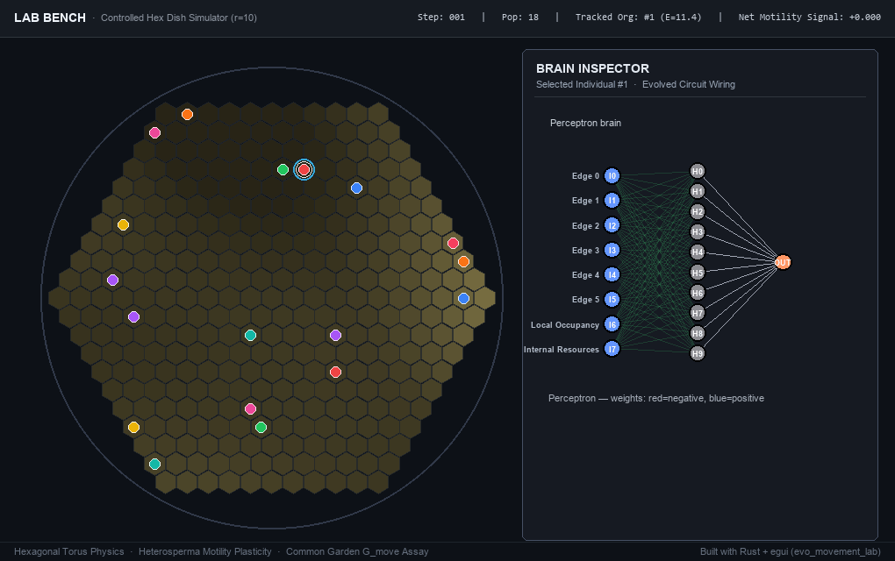

# Evolution of Movement (`evo-movement`)

[](https://www.rust-lang.org/)
[](LICENSE)
[](rust/tests)
[](rust/src/hex_grid.rs)
[](rust/src/simulation.rs)

**Evolutionary emergence of neural motility, developmental dispersal plasticity, and foraging strategies across environmental predictability frontiers.**

---



*Figure 1: The Lab Bench ([`evo_movement_lab`](rust/src/bin/lab.rs)). Real-time 2D hexagonal petri dish ($R=10$, 331 cells) rendered with shifting Perlin resource gradients, lineage-colored organisms, and a live synaptic wiring inspector ([`BrainDiagram`](rust/src/brain_diagram.rs)) tracking sensory input sectors, hidden nodes, and motor readouts. High-definition video available at [`assets/lab_bench_simulation.mp4`](assets/lab_bench_simulation.mp4).*

---

## 1. Overview & Theoretical Framework

Living organisms span a continuum between sessile exploitation and active chemotactic locomotion. Why and when does active movement evolve over sessility, and how do environmental predictability and variability shape neural motor control?

`evo-movement` is a high-performance Rust simulation suite modeling the evolutionary dynamics of autonomous agents in dynamic spatial resource fields.

```
+----------------------------------------------------------------------------------------------------+
|                               THE BOTERO PREDICTABILITY MATRIX (R x P)                             |
|                                                                                                    |
|  Environmental                                                                                     |
|  Predictability (P)                                                                                |
|        ^                                                                                           |
|   1.0  |   CHEMOTACTIC FORAGING                  RUN-AND-TUMBLE MIGRATION                         |
|        |   High neural drive (G_move > 0.8)      Directed displacement, tracking                  |
|        |   Agents surf spatial Perlin gradients  macro-scale patch drift                           |
|        |                                                                                           |
|   0.5  |   DEVELOPMENTAL PLASTICITY              BET-HEDGING                                       |
|        |   *Heterosperma* seed dimorphism        Phenotypic bifurcation,                           |
|        |   Lean patch -> motile dispersal        stochastic flagellar switching                    |
|        |   Rich patch -> sessile exploitation                                                      |
|        |                                                                                           |
|   0.0  |   QUASI-STATIC SESSILITY                HYPER-VOLATILITY COLLAPSE                         |
|        |   G_move -> 0.0, energy conserved       Environmental pace > adaptation speed             |
|        |   Grazing local resource regrowth       Population extinction frontier                     |
|        +-----------------------------------------------------------------------------------------> |
|        0.0                                0.5                               1.0                    |
|                                     Environmental Variability (R)                                  |
+----------------------------------------------------------------------------------------------------+
```

### Key Biological Hypotheses Modeled

1. **The Botero Environmental Matrix ($R \times P$)**:
   Following Botero et al. (2015), environments are parameterized by their rate of change / variability ($R$) and predictability ($P$).
   - **Quasi-static Sessility ($R \le 0.05$)**: When food patches are static, the metabolic cost of movement ($\ge 0.08$ energy/step) selects against motility. Organisms evolve near-zero neural drive ($G_{\text{move}} \approx 0.03$), anchoring in local patches.
   - **Chemotaxis Highways ($P \ge 0.6, R \ge 0.15$)**: Correlated shifting gradients reward directional movement. Organisms evolve positive coupling between directional edge sensors and motor readouts.
   - **Hyper-volatility Collapse**: When temporal frequency outpaces generational turnover ($R \ge 0.35, P \le 0.1$), energetic expenditure outstrips replenishment, leading to population crashes.

2. **Dispersal Plasticity (*Heterosperma* Seed Dimorphism Model)**:
   Inspired by dimorphic plants (*Heterosperma pinnatum*) and wing-dimorphic insects, organisms express a developmental reaction norm allele ($\theta_{\text{morph}}$).
   - If raised on a **lean patch** ($\text{Resource} < \theta_{\text{morph}}$), offspring commit to developing motile machinery (flagella/wings) to disperse.
   - If raised on a **rich patch** ($\text{Resource} \ge \theta_{\text{morph}}$), offspring shed flagellar maintenance and remain sessile to maximize local reproduction.

3. **Genetic vs. Phenotypic Motility Decomposition**:
   A major challenge in evolutionary ecology is disentangling realized behavior from genetic adaptation. Under severe starvation, organisms may appear sessile simply because they lack energy to move.
   - **Realized Locomotion (`prop_moved`)**: The fraction of organisms that physically displaced during simulation steps.
   - **Common Garden Assay ($G_{\text{move}}$)**: At simulation checkpoints, individuals are placed in an unconstrained reference environment ($10\times$ resource saturation, zero movement cost). Their neural networks are probed to measure true intrinsic motor drive ($G_{\text{move}}$), free from environmental masking.

---

## 2. Architecture & Simulator Engine

```
                             +-------------------------------+
                             |    HexDishLayout / HexGrid    |
                             |   6-Connected Axial (q, r)    |
                             +---------------+---------------+
                                             |
                     +-----------------------+-----------------------+
                     |                                               |
                     v                                               v
       +----------------------------+                 +----------------------------+
       |   Circular Isolated Dish   |                 |    2D Hexagonal Torus      |
       |   R=10..14 (331..631 hexes) |                 |    Distance-Preserving     |
       |   Natural wall boundaries  |                 |    Seamless Edge Wrapping  |
       +----------------------------+                 +----------------------------+
                     |                                               |
                     +-----------------------+-----------------------+
                                             |
                                             v
                             +-------------------------------+
                             |      Simulation Engine        |
                             |  - 2D Dynamic Perlin Noise    |
                             |  - Discrete Hex Physics       |
                             |  - Energy & Metabolism Ledger |
                             |  - Cladogram & Lineage Colors |
                             +---------------+---------------+
                                             |
         +-----------------------------------+-----------------------------------+
         |                                   |                                   |
         v                                   v                                   v
+------------------+                +------------------+                +------------------+
|    Perceptron    |                |      MLP-2       |                |  Spatial Graphs  |
| Direct 8-in-1-out|                | 8 -> H1 -> H2    |                | Evolved topology |
| Fast linear map  |                | Latent dynamics  |                | & spatial blobs  |
+------------------+                +------------------+                +------------------+
```

- **Hexagonal Spatial Geometry**: Implements 6-connected hexagonal grids using axial coordinates $(q, r)$. Features both bounded circular petri dishes (for controlled laboratory trials) and toroidal wrapping (for continuous, infinite-plane ecological simulations).
- **Spatiotemporal Perlin Resource Fields**: Continuous 2D Perlin noise evolutions with independent spatial scales ($\sigma_{\text{spatial}}$), time speeds ($v_{\text{time}}$), and contrast controls.
- **Neural Brain Architectures**: Supports modular neural controllers:
  - `Perceptron`: 8 inputs (6 directional hex resource sensors, local crowding, internal energy) $\to$ hidden nodes $\to$ motor decision.
  - `MLP-2`: Deep 2-layer perceptrons with non-linear activation for complex gradient tracking.
  - `SpatialGraph` & `SpatialBlob`: Topologically embedded intracellular nodes with Euclidean distance-based connectivity.

---

## 3. Interactive Visualizers & Lab Bench

The suite provides three visualization and experimentation environments:

### 1. The Lab Bench (`evo_movement_lab`)
A dedicated experimental bench for testing mutation rates, reproduction thresholds, and environmental scales with real-time neural inspection:

```bash
cd rust
cargo run --release --bin evo_movement_lab
```

- **7 Collapsible Control Sections**: Dish & population, manual insertion, time/step multipliers, structural mutations, reproduction economics, Perlin landscape knobs, and metabolism.
- **Live Brain Inspector**: Click any cell to inspect the resident organism's neural wiring, synaptic weights (red=negative, blue=positive), and activation values.

### 2. Multi-Dish Interactive Viewer (`evo_movement_interactive`)
The full desktop application for running and managing multiple independent petri dishes simultaneously:

```bash
cd rust
cargo run --release --bin evo_movement_interactive
```

- **Lineage Color System**: Founders receive unique hues; descendants inherit parental colors to track clade competition in real time.
- **Phylogenetic Cladogram**: Visual ancestry tree tracking divergence, lineage depth, and extinction events.

### 3. Web & Dash Visualizer (`webviewer/`)
For remote or headless deployment, an interactive Python/Dash explorer is included:

```bash
pip install dash plotly numpy
python webviewer/interactive_dash.py --port 8050
```

---

## 4. Quickstart & Command-Line Usage

### Prerequisites
- [Rust 1.70+](https://www.rust-lang.org/) (`cargo`)
- Python 3.10+ (for sweep drivers and animation rendering)

### Build the Rust Engine
```bash
cd rust
cargo build --release
```

### Run a Headless Simulation
```bash
./target/release/evo_movement_rust.exe \
  --config-file=../rust/src/bin/sample_config.json \
  --steps=500 \
  --report-interval=10
```

### Run the Expanded Botero ($R \times P$) Sweep
To execute the multi-seed environmental predictability vs. variability parameter sweep:

```bash
python scripts/run_expanded_botero_sweep.py --workers=4
```

Outputs are automatically collated into publication-ready heatmaps and summary tables detailing:
- Proportion of active movers (`prop_moved`)
- Intrinsic Common Garden motor drive ($G_{\text{move}}$)
- Mean reaction norm threshold ($\theta_{\text{morph}}$)
- Adaptation speed and extinction boundaries

### Export Lab Bench Animation
To re-render the authentic Lab Bench animation:

```bash
# Export simulation frame stream (100 steps)
cargo run --manifest-path rust/Cargo.toml --release --bin evo_lab_bench_export -- rust/temp_outputs/lab_bench_stream.jsonl 100

# Render GIF and MP4
python scripts/render_lab_bench_animation.py
```

---

## 5. Repository Layout

```
.
├── assets/                       # Publication animations, GIF showcases, and preview posters
│   ├── lab_bench_simulation.gif  # High-impact Lab Bench simulation animation
│   ├── lab_bench_simulation.mp4  # 60fps MP4 video recording
│   └── lab_bench_preview.png     # Static preview poster
├── rust/                         # Core Rust simulation engine & GUI visualizers
│   ├── src/
│   │   ├── bin/                  # Executables: lab.rs, interactive.rs, export_lab_bench.rs
│   │   ├── brain/                # Neural controllers (Perceptron, MLP, SpatialGraph, GooGraph)
│   │   ├── brain_diagram.rs      # Decoupled diagram layout engine for UI rendering
│   │   ├── hex_grid.rs           # 6-connected hexagonal coordinate math & geometry
│   │   ├── hex_dish.rs           # Circular dish & toroidal boundary algorithms
│   │   ├── lab_dish.rs           # State container for controlled Lab Bench trials
│   │   ├── simulation.rs         # Core evolutionary loop & common garden assays
│   │   └── step_engine.rs        # Action resolution, foraging, and heterosperma plasticity
│   └── tests/                    # 67 unit and integration tests
├── scripts/                      # Sweep runners and animation rendering pipelines
│   ├── run_expanded_botero_sweep.py
│   └── render_lab_bench_animation.py
└── webviewer/                    # Dash & HTML5 browser exploration suite
```

---

## 6. Acknowledgments & Credits

This project builds upon foundational theoretical and computational work in evolutionary ecology:

- **[Franjo Weissing](https://research.rug.nl/en/persons/franjo-weissing/)** (University of Groningen) — Foundational theoretical work on the evolutionary ecology of movement, dispersal plasticity, and adaptive dynamics.
- **[Hanno Hildenbrandt](https://research.rug.nl/en/persons/hanno-hildenbrandt)** (University of Groningen) — Initial C++ simulation codebase and high-performance spatial modeling architecture.
- **[Christoph Netz](https://www.su.se/english/profiles/c/chne0650)** (Stockholm University) — Theoretical modeling and evolutionary simulation work.

---

## 7. License & Citation

This project is licensed under the MIT License — see the [LICENSE](LICENSE) file for details.

If you use `evo-movement` or its developmental plasticity / common garden assays in academic work, please cite:

```bibtex
@software{boullosa2026evomovement,
  author = {Luis Boullosa and Hanno Hildenbrandt and Christoph Netz and Franjo Weissing},
  title = {Evolution of Movement: Emergence of Neural Motility and Developmental Plasticity in Hexagonal Spatial Environments},
  year = {2026},
  url = {https://github.com/luisboullosa/Evolution_of_Movement}
}
```
